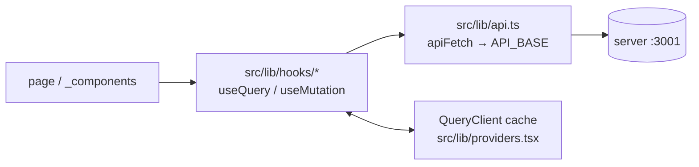

# client — architecture

Next.js 15 App Router web app (`@devdigest/web`) on :3000. It is a thin UI over the
server API on :3001: all data goes through TanStack Query hooks, and UI strings
through next-intl. Commands are in [`../AGENTS.md`](../AGENTS.md); the screen list is in
[`../README.md`](../README.md).

## Route map (`src/app`)

| Route | Screen |
|-------|--------|
| `/` | Redirects to the first repo's PR list (empty state when there are no repos) |
| `/repos/[repoId]/pulls` | PR list: `PRRow` with score, severity counters, total COST |
| `/repos/[repoId]/pulls/[number]` | PR detail tabs (Overview, findings, diff, run history, trace drawer) |
| `/agents`, `/agents/[id]` | Agent list and editor (tabs: Config, Skills — link / unlink / reorder the agent's skills) |
| `/skills`, `/skills/new`, `/skills/[id]` | Skills Lab: skill list + editor (tabs: Config, Preview, Stats, Versions) and the import modal (`.md` / `.zip`, preview before save) |
| `/settings/[section]` | Settings sub-nav (`SETTINGS_SECTIONS` from `@devdigest/ui`): API keys (OpenRouter + GitHub PAT), … |
| `/onboarding` | Add a repository (`_components/AddRepoView`) |

Page-private components live in `_components/` next to the page that uses them.
Shared components live in `src/components/`.

## Data layer

- `apiFetch` (`src/lib/api.ts:21`) prefixes `API_BASE` (`NEXT_PUBLIC_API_BASE`, default `http://localhost:3001`). If the API can't be reached it throws an `ApiError` with a readable message.
- Hooks are grouped by area: `core.ts` (settings, repos, pulls), `agents.ts`, `reviews.ts`, `trace.ts`, `repo-intel.ts`.
- All query keys come from the factories in `src/lib/hooks/keys.ts`, and their values are pinned by `keys.test.ts`. The main ones:
  - `pullKeys.list(repoId)` = `["pulls", repoId]`: the list (`usePulls`, `src/lib/hooks/core.ts:103`). Rows carry the server's `severity_counts`.
  - `pullKeys.detail(prId)` = `["pull", prId]`: the detail, including the total and latest-round cost (`usePullDetail`, `core.ts:116`). `usePullByNumber` (`core.ts:130`) loads the detail by the route's PR number in one request and seeds this key.
  - `reviewKeys.forPr(prId)` = `["reviews", prId]`: reviews with findings.
- When a run settles, `useInvalidateAfterRun(prId).all` (`src/lib/hooks/reviews.ts:68`) refreshes in-flight runs, run history, reviews, the PR detail (Overview cost) and every PR list (severity counters).
- Route files are thin. Each `page.tsx` reads params and renders a `_components/<Name>View`. `error.tsx`, `not-found.tsx`, `global-error.tsx` and per-segment `loading.tsx` live under `src/app/`.

## Shared components

- `SeverityCounters` (`src/components/severity-counters/SeverityCounters.tsx:41`):
  - one component for the run card (acts as a filter; click again to clear), the Timeline, and the PR list (shows a findings preview on hover)
  - presentational: it takes `counts` (precomputed, e.g. the PR list's `severity_counts`) or derives them from `findings`, and never fetches itself; the PR list's `PRRow` loads the findings for the popover lazily on first hover
- `ConfirmDialog` / `useConfirm()` (`src/components/confirm-dialog/`): the replacement for `window.confirm`, with focus trap, Escape and focus restore
- `RunCostBadge` (`src/components/run-cost-badge/RunCostBadge.tsx:38`):
  - variants `compact` (PR list), `inline` (timeline) and `detailed` (Overview)
  - "no data" renders "—", never `$0`

## Invariants

- No literal UI strings: use `messages/en/*.json` through `useTranslations`. Only the `en` locale exists.
- `src/vendor/shared` is a separate copy of the server contracts, so a contract change goes into both.
- Component tests mock `fetch` and wrap renders in `NextIntlClientProvider` with the needed message files.
- `pnpm typecheck` catches contract mismatches (e.g. an invalid `Severity` in fixtures) that vitest misses.
