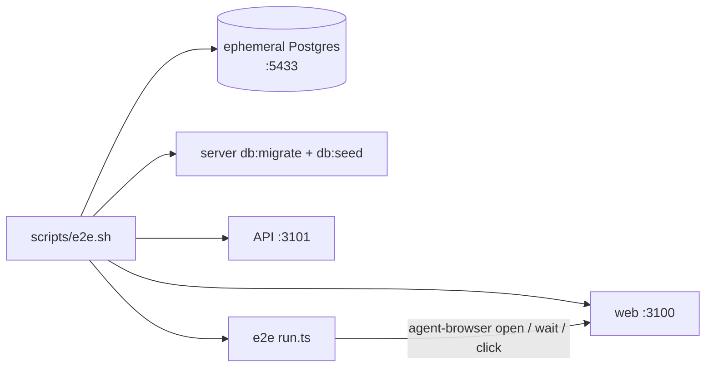

# e2e — architecture

Deterministic browser flows (`@devdigest/e2e`) driven by the
[agent-browser](https://github.com/vercel-labs/agent-browser) CDP CLI. They run on
seeded demo data only, with no LLM calls and no API keys. Commands are in
[`../CLAUDE.md`](../CLAUDE.md).

## Pieces

| Path | Role |
|------|------|
| `specs/NN-name.flow.json` | One flow: `name`, `description`, and `steps[]` of agent-browser commands |
| `run.ts` | Runner: picks up every `*.flow.json` in lexical order and runs each step in one shared browser session |
| `lib/assert.ts` | Light substring checks on top of agent-browser's own waits |
| `../scripts/e2e.sh` | Hermetic harness: throwaway Postgres, migrate + seed, API + web on alternate ports, run, tear down |

## Flow

- Steps are agent-browser commands, e.g. `["open", "{BASE}/"]` or `["wait", "--text", "Pull Requests"]`. `{BASE}` is replaced with `E2E_BASE_URL`.
- A command that exits non-zero fails the step and the flow, including a `wait` whose condition never holds.
- Env vars: `E2E_BASE_URL`, `AGENT_BROWSER_BIN`, `E2E_STEP_TIMEOUT`. The script ports can be changed with `E2E_PG_PORT`, `E2E_API_PORT`, `E2E_WEB_PORT`.
- `e2e.sh` refuses to migrate or seed anything except the isolated port, so it never touches the dev DB.

## Extension points

- **New flow:** add `specs/NN-name.flow.json` with the next number, and don't renumber existing ones. Add its row to `specs/README.md`.
- Flows must stay read-only against seeded data and must not trigger a review run, since that would need an LLM.

## Invariants

- Each flow should be independent of the others where it can be (`01-app-boot` is an order-independent smoke test).
- Design notes go in `docs/`; `specs/` holds only executable flows and their index.
