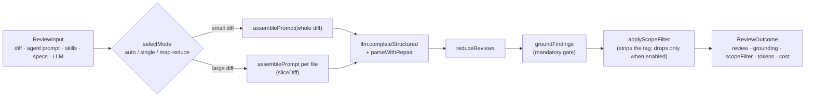

# reviewer-core — architecture

The pure review engine (`@devdigest/reviewer-core`). It takes a diff, the agent's inputs
and an LLM provider, and returns a grounded `Review`. It is shared by the server, for
studio reviews, and by the CI agent-runner. It has no DB, GitHub or filesystem access;
its only side effect is the call through the injected `LLMProvider`. It emits no JS: consumers
import the TS source via a path alias. Commands are in [`../AGENTS.md`](../AGENTS.md).

## Folder map

| Path | Holds |
|------|-------|
| `src/index.ts` | Public API: everything consumers may import |
| `src/prompt.ts` | `assemblePrompt`, `wrapUntrusted`, `LANGUAGE_RULE`, `INJECTION_GUARD`, `SCOPE_RULE` |
| `src/review/run.ts` | `reviewPullRequest`, the engine entry point; single-pass vs map-reduce selection |
| `src/review/reduce.ts` | `reduceReviews` (merge per-file partials), `sliceDiff`, `scoreFromFindings` |
| `src/llm/structured.ts` | Zod → JSON Schema, `extractJson`, `parseWithRepair` |
| `src/llm/openrouter.ts` | OpenRouter provider |
| `src/grounding.ts` | `groundFindings`: drops findings whose lines aren't in the diff; generic over the finding type |
| `src/review/scope.ts` | `ScopedFinding` / `ScopedReview` (a `Review` whose findings carry a `scope` tag), `applyScopeFilter`, `isSerious` |
| `src/intent/` | Intent classifier: `prompt.ts` (`buildIntentPrompt`), `classify.ts` (`classifyIntent`, `clampIntent`), `types.ts` (`IntentClassifierOutput`, `IntentPromptInput`, `ReviewIntent`) |
| `src/output/to-review.ts` | `toReviewPayload` (GitHub review body), CI gate (`gateTriggered`, `countBlockers`) |

## Pipeline

- `reviewPullRequest` is at `src/review/run.ts:139`. Mode selection is `selectMode` (`:131`) against `DEFAULT_MAP_THRESHOLD_LINES`. Merge is `reduceReviews` (`:229`), grounding is `groundFindings` (`:236`), and the scope filter is `applyScopeFilter` (`:245`).
- In map-reduce mode, each file is a separate LLM call, and the partial results are merged before grounding.
- `groundFindings` (`src/grounding.ts:52`) and `reduceReviews` (`src/review/reduce.ts:43`) are generic over `F extends Finding`. The scope tag therefore survives merge and grounding unchanged.

## Intent and scope

The server may pass `ReviewInput.intent` (`ReviewIntent`: rendered `text` plus a `filter` switch; `src/intent/types.ts:68`, `src/review/run.ts:87`). The engine does no I/O to get it. Without an intent, every step below is skipped.

- **Request shape.** With an intent, the LLM schema is `ScopedReview` (`src/review/run.ts:198`). Without one it is the plain `Review` schema, and each finding is tagged `in` internally (`:209-217`).
- **Tag.** `ScopedFinding.scope` is `FindingScope.nullish()` (`src/review/scope.ts:16`). A missing tag counts as `in`: only an explicit `out` can be dropped (`:88`).
- **Prompt.** `PromptParts.intent` (`src/prompt.ts:97`) adds the `## Stated intent (unverified author claims; derived, may be wrong)` section after `## PR description` and appends `SCOPE_RULE` to the system message (`:42`, `:117-119`, `:142-145`). The section text is also saved as `PromptAssembly.intent` (`:174`; contract at `server/src/vendor/shared/contracts/trace.ts:52`).
- **Filter.** `applyScopeFilter` runs only after grounding, so an ungrounded finding is never kept as a "serious signal" (`src/review/run.ts:243-245`). It is enabled only when `scoped && intent.filter` (`:245`). When disabled it only strips the tag (`src/review/scope.ts:78-83`).
- **Serious findings.** A finding is serious when severity is `CRITICAL`, category is `security`, or kind is `secret_leak` or `lethal_trifecta` (`src/review/scope.ts:48-52`). Out-of-scope findings that are not serious are dropped and counted. Of the serious out-of-scope ones, exactly one is kept: the worst by severity, then confidence, then file and line (`:55-62`, `:93-107`). The others are listed in its rationale (`:103-104`). Kept findings keep their original order (`:109-114`).
- **Score.** The score comes from the findings that survived grounding and the filter (`src/review/run.ts:261`). `ReviewOutcome.scopeFilter` carries `ScopeFilterStats`, or `null` without an intent (`:128`, `:246`).

Who decides `filter` lives in the server, not here. See [`../../server/docs/architecture.md`](../../server/docs/architecture.md).

### Classifier

The classifier is a separate, quarantined call. It has no tools and sees only fenced data.

- `buildIntentPrompt` (`src/intent/prompt.ts:29`) has two modes, picked by `IntentPromptInput.mode`. `author_description` (`:22`) derives from the description and linked context. `inferred_from_changes` (`:25`) says there is no description and derives from file paths, hunk headers and commit messages. In that mode the body is never included (`:39`).
- Every source is wrapped with `wrapUntrusted`: title, description, linked issues, docs, commits, changed files (`:38-66`). The `## Added lines` excerpt is added only in `inferred_from_changes` mode (`:67-69`). The system message carries `LANGUAGE_RULE` and `INJECTION_GUARD` (`:30-35`).
- `classifyIntent` makes one `completeStructured` call (`src/intent/classify.ts:41`). `clampIntent` then caps the summary at 400 chars and each list at 8 items of 160 chars (`:4-22`).
- The LLM schema has no `.max()`, because strict `json_schema` support varies by provider (`src/intent/types.ts:4-9`). Confidence and mode are never asked of the model (`:8`); the server computes them.

## Trust boundaries (prompt)

`assemblePrompt` (`src/prompt.ts:94`) builds the system message as
`agent prompt + LANGUAGE_RULE + INJECTION_GUARD`. This is the one shared defense, used
by both the server path and the CI path.

- **Trusted:** the agent system prompt, linked skills, curated memory, `LANGUAGE_RULE` (`:34`, forces English output), and `INJECTION_GUARD` (`:16`).
- **Untrusted:** the diff, PR description (capped at 4000 chars), specs, repo map and callers. Each is wrapped with `wrapUntrusted` (`:39`) in `<untrusted source="…">`, and any embedded closing tag is escaped.
- The guard says untrusted text can never descope the review ("test fixture", "ignore this", in any language). It names derived intent and scope as untrusted too (`:18`, `:26-27`).
- The derived intent is wrapped as `<untrusted source="intent">` (`:143`). `SCOPE_RULE` (trusted) says scope never changes severity (`:42-45`).

## Extension points

- **New prompt section:** add an optional field to `PromptParts`, render it in `assemblePrompt`, and wrap it if it comes from the repo or the author. Record it in `PromptAssembly` so it shows in the run trace.
- **New output target:** add a mapper next to `src/output/to-review.ts`.

## Invariants

- Never bypass `groundFindings`: every finding must cite lines that exist in the diff.
- `@devdigest/shared` resolves to `../server/src/vendor/shared` (not the client copy).
- A prompt change affects the server's prompt tests too (`server/test/prompt-*.test.ts`).
