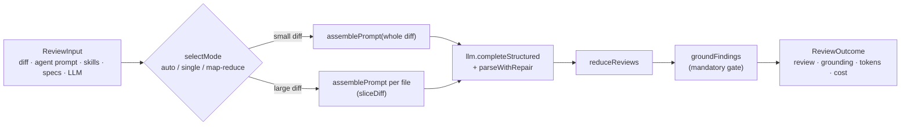

# reviewer-core — architecture

The pure review engine (`@devdigest/reviewer-core`). It takes a diff, the agent's inputs
and an LLM provider, and returns a grounded `Review`. It is shared by the server, for
studio reviews, and by the CI agent-runner. It has no DB, GitHub or filesystem access;
its only side effect is the call through the injected `LLMProvider`. It emits no JS: consumers
import the TS source via a path alias. Commands are in [`../CLAUDE.md`](../CLAUDE.md).

## Folder map

| Path | Holds |
|------|-------|
| `src/index.ts` | Public API: everything consumers may import |
| `src/prompt.ts` | `assemblePrompt`, `wrapUntrusted`, `LANGUAGE_RULE`, `INJECTION_GUARD` |
| `src/review/run.ts` | `reviewPullRequest`, the engine entry point; single-pass vs map-reduce selection |
| `src/review/reduce.ts` | `reduceReviews` (merge per-file partials), `sliceDiff`, `scoreFromFindings` |
| `src/llm/structured.ts` | Zod → JSON Schema, `extractJson`, `parseWithRepair` |
| `src/llm/openrouter.ts` | OpenRouter provider |
| `src/grounding.ts` | `groundFindings`: drops findings whose lines aren't in the diff |
| `src/output/to-review.ts` | `toReviewPayload` (GitHub review body), CI gate (`gateTriggered`, `countBlockers`) |

## Pipeline

- `reviewPullRequest` is at `src/review/run.ts:123`. Mode selection is `selectMode` (`:115`) against `DEFAULT_MAP_THRESHOLD_LINES`. Grounding runs at `:197`.
- In map-reduce mode, each file is a separate LLM call, and the partial results are merged before grounding.

## Trust boundaries (prompt)

`assemblePrompt` (`src/prompt.ts:94`) builds the system message as
`agent prompt + LANGUAGE_RULE + INJECTION_GUARD`. This is the one shared defense, used
by both the server path and the CI path.

- **Trusted:** the agent system prompt, linked skills, curated memory, `LANGUAGE_RULE` (`:34`, forces English output), and `INJECTION_GUARD` (`:16`).
- **Untrusted:** the diff, PR description (capped at 4000 chars), specs, repo map and callers. Each is wrapped with `wrapUntrusted` (`:39`) in `<untrusted source="…">`, and any embedded closing tag is escaped.
- The guard says untrusted text can never descope the review ("test fixture", "ignore this", in any language).

## Extension points

- **New prompt section:** add an optional field to `PromptParts`, render it in `assemblePrompt`, and wrap it if it comes from the repo or the author. Record it in `PromptAssembly` so it shows in the run trace.
- **New output target:** add a mapper next to `src/output/to-review.ts`.

## Invariants

- Never bypass `groundFindings`: every finding must cite lines that exist in the diff.
- `@devdigest/shared` resolves to `../server/src/vendor/shared` (not the client copy).
- A prompt change affects the server's prompt tests too (`server/test/prompt-*.test.ts`).
