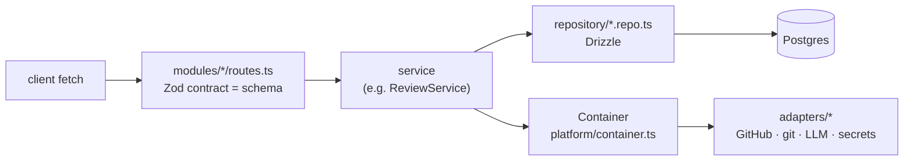
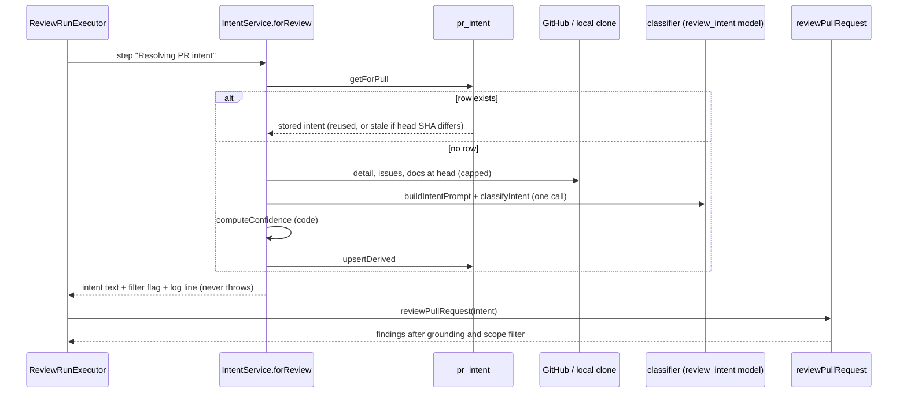

# server — architecture

Fastify API (`@devdigest/api`) on :3001. It owns persistence (Drizzle on Postgres +
pgvector), external integrations (GitHub, git, LLM providers), and runs reviews by
calling `reviewer-core`. Commands are in [`../AGENTS.md`](../AGENTS.md); routes and
adapters are listed in [`../README.md`](../README.md).

## Folder map

| Path | Holds |
|------|-------|
| `src/server.ts` → `src/app.ts` | Boot; `buildApp` wires plugins, the error handler and modules |
| `src/modules/<name>/routes.ts` | One Fastify plugin per feature (`settings`, `repos`, `pulls`, `polling`, `workspace`, `agents`, `skills`, `reviews`, `repoIntel`) |
| `src/modules/index.ts` | Static module registry; `app.ts:188` registers each entry |
| `src/modules/reviews/` | Review runs: `service.ts` (API-facing), `run-executor.ts` (background execution), `deps.ts` (their injected deps), `repository/*.repo.ts` (SQL), `cost.ts` (pure cost math) |
| `src/modules/intent/` | PR intent: `routes.ts` (`GET /pulls/:id/intent`, `POST /pulls/:id/intent/derive`), `service.ts` (`get`, `derive`, `forReview`, per-PR single-flight), `repository.ts` (owns `pr_intent`), `helpers.ts` (pure caps, reference extraction, confidence, log lines), `constants.ts`, `deps.ts`, `ports.ts` (module-local port `RepoFileAtRef`) |
| `src/modules/pulls/` | PR import + reads: `service.ts` (sync gate, detail TTL, comments), `repository.ts` (SQL, batched upsert, transactional detail replace), `helpers.ts` (DTO mapping, severity rollup) |
| `src/modules/repo-intel/` | Repo-intel facade `service.ts` over `indexer.ts`, `blast.ts`, `queries.ts`, `repo-map-reader.ts`; `disabled.ts` is the Null Object used when `REPO_INTEL_ENABLED` is off |
| `src/platform/` | Cross-cutting infrastructure: DI `container.ts`, `config.ts`, `price-book.ts`, `sse.ts`, `jobs.ts`, `run-logger.ts` |
| `src/adapters/` | Implementations behind the container (github, git, llm, secrets, embedder, …); `mocks.ts` for tests. `git/file-at-ref.ts` implements `RepoFileAtRef` |
| `src/db/` | `schema.ts`, `client.ts`, `migrate.ts`, `seed.ts`, `migrations/` (do not hand-edit) |
| `src/vendor/shared/` | Zod contracts shared with `reviewer-core` (do not hand-edit without coordination) |

## Request flow



- Route schemas, for both request and response, are the Zod contracts from `src/vendor/shared`.
- External systems are reached only through the `Container` (`src/platform/container.ts:66`). Tests swap them with `ContainerOverrides` and `src/adapters/mocks.ts`.
- API keys are read only through `LocalSecretsProvider` (`src/adapters/secrets/local.ts:16`).
- Every application service is built once in the `Container` (`reposService`, `agentsService`, `skillsService`, `reviewService`, `pullsService`, `settingsService`, `repoIntelService`) from a narrow deps interface. Routes, job handlers and boot code read it from there and never construct one themselves.
- Unexpected errors become a generic `500 internal_error`. The detail goes only to the log (`src/app.ts:129`, `setErrorHandler`).

## PR sync flow (local-first)

- `GET /repos/:id/pulls` (`PullsService.list`, `src/modules/pulls/service.ts:50`) re-syncs from GitHub only when `repos.last_polled_at` is older than `PULL_SYNC_MIN_INTERVAL_MS`. Every other call is a pure Postgres read, even though the client polls it every 60 s.
- A sync (`syncFromGitHub`, `:79`) is one batched upsert plus a back-fill of diff stats for at most `BACKFILL_LIMIT` PRs. `POST /repos/:id/poll` forces one.
- `GET /pulls/:id` and `GET /repos/:id/pulls/by-number/:number` refresh files, commits and body from GitHub at most once per `DETAIL_REFRESH_TTL_MS` per PR. The write is a single transaction (`PullsRepository.replaceDetail`, `src/modules/pulls/repository.ts:166`).
- With no token, or offline, both serve the persisted rows and never fail the read.
- The list rows carry `severity_counts`: each agent's latest review, without dismissed findings. The PR list therefore makes no request per row.

## Review run flow

```mermaid
sequenceDiagram
  participant UI as client
  participant RS as ReviewService.runReview
  participant EX as ReviewRunExecutor
  participant RC as reviewer-core
  participant DB as Postgres
  UI->>RS: POST run review (agents[])
  RS->>DB: createAgentRun per agent (status=running, shared batchId)
  RS-->>UI: run ids (SSE stream per run)
  RS->>EX: execute in background
  EX->>RC: reviewPullRequest(diff, agent, llm)
  RC-->>EX: grounded Review + tokens + costUsd
  EX->>DB: review + findings; run status=done, cost_usd, tokens
```

- `ReviewService.runReview` (`src/modules/reviews/service.ts:107`) generates one `batchId` per request (`:125`). That batch is one "review round".
- `ReviewRunExecutor` (`src/modules/reviews/run-executor.ts:43`) calls `reviewPullRequest` (`:190`) and stores `costUsd` and tokens on the run (`:244-248`). A failure in one agent doesn't affect the others.

## PR intent (Intent Layer)



- **Step.** The executor runs the step "Resolving PR intent" once per run, before the agents, and logs its line (`src/modules/reviews/run-executor.ts:108-118`). It passes `intent.intent` to each agent run (`:228`). The reviews module sees the intent only through the structural `ReviewIntentResolution` (`src/modules/reviews/deps.ts:9`), wired in the container (`src/platform/container.ts:219`).
- **Best effort.** `forReview` catches every error and returns `outcome: 'unavailable'` (`src/modules/intent/service.ts:151-159`). A failure never fails the review.
- **Routes.** `GET` reads the stored row with no LLM call (`src/modules/intent/service.ts:83`). `POST .../derive` re-derives and is limited to 10 calls per minute (`src/modules/intent/routes.ts:26-31`).
- **Single-flight.** Concurrent derives for one PR share one promise (`service.ts:179-185`).
- **Staleness.** An intent is stale when its stored head SHA is missing or differs from the PR head (`src/modules/intent/helpers.ts:373`). A stale intent is reused as context only; it is not re-derived during a review (`service.ts:109-114`).
- **Mode.** `inferred_from_changes` when the body is empty or only template scaffolding with fewer than `MIN_AUTHOR_CHARS` (40) real characters; otherwise `author_description` (`helpers.ts:61-90`, `constants.ts:7`, `service.ts:205-207`).
- **Confidence is computed in code, never by the model** (`helpers.ts:362-370`). No in-scope items gives `low`. In changes-only mode it is `medium` only with no missing context and a descriptive commit subject, else `low`. With a description it is `high` when an issue or doc was fetched and nothing is missing, else `medium`.
- **Filter on/off.** The filter is on only for `author_description`, confidence not `low`, and not stale (`helpers.ts:378-384`). When off, the executor logs `scope filter: off (<reason>)` (`run-executor.ts:238-240`; reasons at `helpers.ts:387-395`).

### Data sources and caps

Caps are in `src/modules/intent/constants.ts`.

| Source | Cap |
|--------|-----|
| Title | 300 chars (`:10`) |
| Body | 10,000 chars (`:11`) |
| Linked issues | 3, each body 10,000 chars (`:12-13`) |
| Plan/spec docs | 3, each 10,000 chars (`:14-15`) |
| Recorded but unfetched references | 10 (`:17`) |
| Changed files | 150, largest changes first (`:18`, `helpers.ts:256-260`) |
| Hunk headers | 5 per file, 160 chars each, 6,000 chars total (`:19-21`) |
| Commits | 20, body 300 chars; merge commits skipped (`:22-23`, `helpers.ts:326-335`) |
| PR template probe | 4 candidate paths, 10,000 chars (`:43-49`) |
| Each GitHub or git read | 10 s timeout (`:26`) |

- **Docs.** Only repo-relative markdown under `docs/` or `specs/` is read, at the PR head, through `git show <sha>:<path>` (`constants.ts:53`, `helpers.ts:105-109`, `src/adapters/git/file-at-ref.ts:33-52`). The adapter re-checks sha and path, rejects files over 100 KB, takes no shell, and never reads the working tree (`file-at-ref.ts:5-23`).
- **No external URL is ever fetched.** `extractReferences` only fetches issues through the GitHub client. Any other URL is recorded as `host_not_allowlisted` with its query string and fragment removed (`helpers.ts:92-102`, `:183-201`). Docs outside the allowlist are recorded as `path_not_allowlisted` (`:164-168`).
- **Small-PR excerpt.** In changes-only mode only, and only when the PR changes fewer than 50 lines, the classifier also gets up to 40 added (`+`) lines, 200 chars each. Lines that look like credentials become `[redacted]` (`helpers.ts:293-316`, `constants.ts:30-40`, `service.ts:257-268`).

### Ports and wiring

- `RepoFileAtRef` is a module-local port (`src/modules/intent/ports.ts:21`). The container builds `GitFileAtRefReader` over the clone path (`src/platform/container.ts:254-258`).
- Tests swap both seams through `ContainerOverrides.repoFiles` and `ContainerOverrides.intentService` (`container.ts:71`, `:79`, `:181`).
- `IntentService` receives only `IntentDeps` (`src/modules/intent/deps.ts:32`), never the container.

### Logging and redaction

- The live run log gets one line from `formatIntentLogLine`: provider, model, mode, confidence, source kinds, refs and counts only (`helpers.ts:469-490`). It never contains body, issue, doc or commit text.
- The structured log carries the same metadata (`service.ts:322-340`).
- On failure, only `safeErrorSummary` reaches the log: the first line of the message, capped at 120 chars, because provider errors can quote model output (`helpers.ts:502-507`, `service.ts:154-155`).

## Cost aggregation

- `runCost` (`src/modules/reviews/cost.ts:22`): the stored cost wins; otherwise it estimates tokens × `PriceBook`. "No data" is `null`, never 0.
- `totalUsage` (`cost.ts:75`): all completed runs of a PR. Feeds the PR list COST column and the Overview total.
- `latestRoundUsage` (`cost.ts:51`): the newest `batchId` only. Feeds the Overview "Latest round" line.
- `usageForPulls` (`src/modules/reviews/repository/run.repo.ts:92`) computes both from one query. `PullsService` gets it as the injected `usageForPulls` function (`src/platform/container.ts:156`) and uses it for the list (`src/modules/pulls/service.ts:59`) and the detail (`:206`).

## Extension points

Layering rules (which file may import what) live in the `onion-architecture` skill (`../../.claude/skills/onion-architecture/SKILL.md`).

- **New feature module:** create `src/modules/<name>/routes.ts`, then add one import and one entry in `src/modules/index.ts`.
- **New external system:** add an adapter in `src/adapters/`, expose it from the `Container`, and add a mock in `mocks.ts`.
- **Contract change:** edit both `server/src/vendor/shared` and `client/src/vendor/shared`, because the two copies have already diverged.

## Invariants

- Migrations are not applied on boot; run `pnpm db:migrate`.
- Only `status='done'` runs count toward cost, so an in-flight round is not shown yet.
- `*.it.test.ts` needs Docker; every other test is hermetic.
