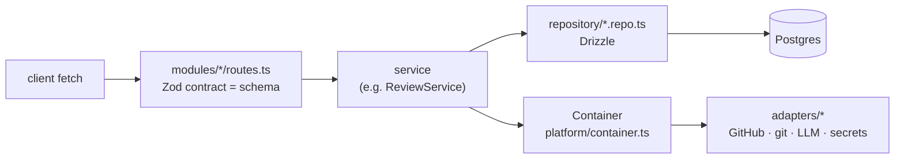

# server — architecture

Fastify API (`@devdigest/api`) on :3001. It owns persistence (Drizzle on Postgres +
pgvector), external integrations (GitHub, git, LLM providers), and runs reviews by
calling `reviewer-core`. Commands are in [`../AGENTS.md`](../AGENTS.md); routes and
adapters are listed in [`../README.md`](../README.md).

## Folder map

| Path | Holds |
|------|-------|
| `src/server.ts` → `src/app.ts` | Boot; `buildApp` wires plugins, the error handler and modules |
| `src/modules/<name>/routes.ts` | One Fastify plugin per feature (`settings`, `repos`, `pulls`, `polling`, `workspace`, `agents`, `reviews`, `repoIntel`) |
| `src/modules/index.ts` | Static module registry; `app.ts:182` registers each entry |
| `src/modules/reviews/` | Review runs: `service.ts` (API-facing), `run-executor.ts` (background execution), `repository/*.repo.ts` (SQL), `cost.ts` (pure cost math) |
| `src/platform/` | Cross-cutting infrastructure: DI `container.ts`, `config.ts`, `price-book.ts`, `sse.ts`, `jobs.ts`, `run-logger.ts` |
| `src/adapters/` | Implementations behind the container (github, git, llm, secrets, embedder, …); `mocks.ts` for tests |
| `src/db/` | `schema.ts`, `client.ts`, `migrate.ts`, `seed.ts`, `migrations/` (do not hand-edit) |
| `src/vendor/shared/` | Zod contracts shared with `reviewer-core` (do not hand-edit without coordination) |

## Request flow



- Route schemas, for both request and response, are the Zod contracts from `src/vendor/shared`.
- External systems are reached only through the `Container` (`src/platform/container.ts:56`). Tests swap them with `ContainerOverrides` and `src/adapters/mocks.ts`.
- API keys are read only through `LocalSecretsProvider` (`src/adapters/secrets/local.ts:16`).

## Review run flow

```mermaid
sequenceDiagram
  participant UI as client
  participant RS as ReviewService.runReview
  participant EX as ReviewRunExecutor
  participant RC as reviewer-core
  participant DB as Postgres
  UI->>RS: POST run review (agents[])
  RS->>DB: createAgentRun per agent (status=running, shared batchId)
  RS-->>UI: run ids (SSE stream per run)
  RS->>EX: execute in background
  EX->>RC: reviewPullRequest(diff, agent, llm)
  RC-->>EX: grounded Review + tokens + costUsd
  EX->>DB: review + findings; run status=done, cost_usd, tokens
```

- `ReviewService.runReview` (`src/modules/reviews/service.ts:105`) generates one `batchId` per request (`:123`). That batch is one "review round".
- `ReviewRunExecutor` (`src/modules/reviews/run-executor.ts:43`) calls `reviewPullRequest` (`:190`) and stores `costUsd` and tokens on the run (`:244-248`). A failure in one agent doesn't affect the others.

## Cost aggregation

- `runCost` (`src/modules/reviews/cost.ts:22`): the stored cost wins; otherwise it estimates tokens × `PriceBook`. "No data" is `null`, never 0.
- `totalUsage` (`cost.ts:75`): all completed runs of a PR. Feeds the PR list COST column and the Overview total.
- `latestRoundUsage` (`cost.ts:51`): the newest `batchId` only. Feeds the Overview "Latest round" line.
- `usageForPulls` (`src/modules/reviews/repository/run.repo.ts:92`) computes both from one query. It is used by `src/modules/pulls/routes.ts:138` (list) and `:187` (detail).

## Extension points

- **New feature module:** create `src/modules/<name>/routes.ts`, then add one import and one entry in `src/modules/index.ts`.
- **New external system:** add an adapter in `src/adapters/`, expose it from the `Container`, and add a mock in `mocks.ts`.
- **Contract change:** edit both `server/src/vendor/shared` and `client/src/vendor/shared`, because the two copies have already diverged.

## Invariants

- Migrations are not applied on boot; run `pnpm db:migrate`.
- Only `status='done'` runs count toward cost, so an in-flight round is not shown yet.
- `*.it.test.ts` needs Docker; every other test is hermetic.
